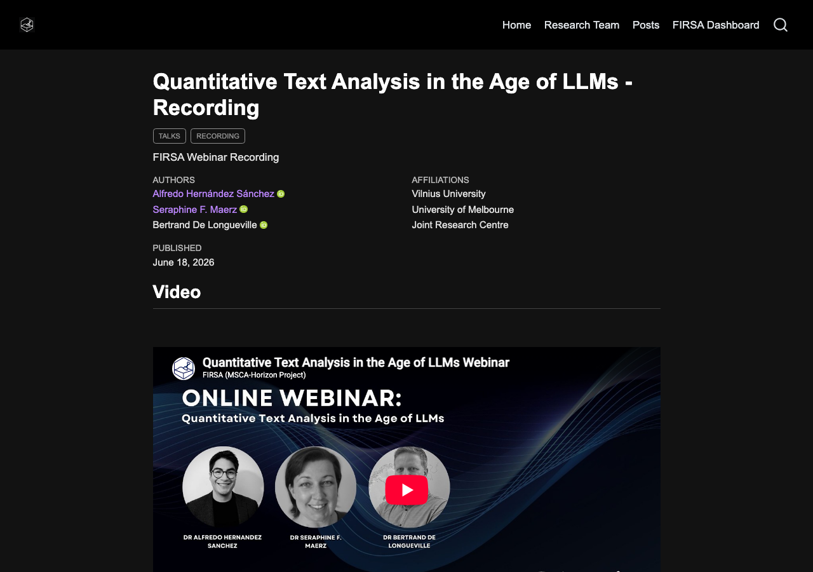
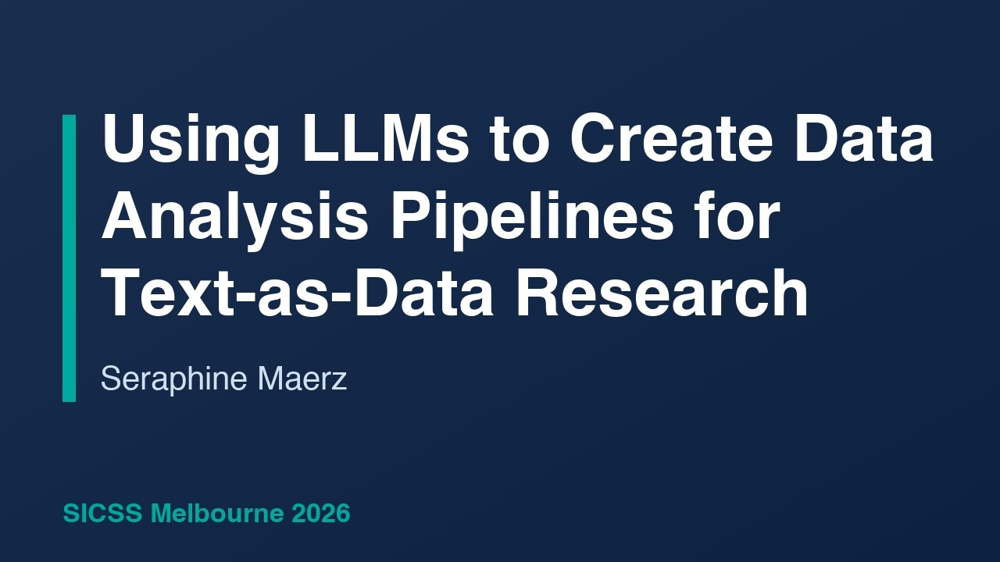
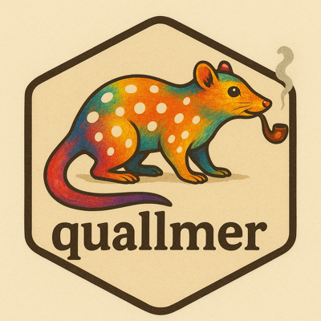
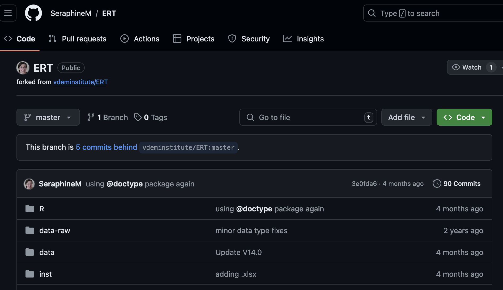
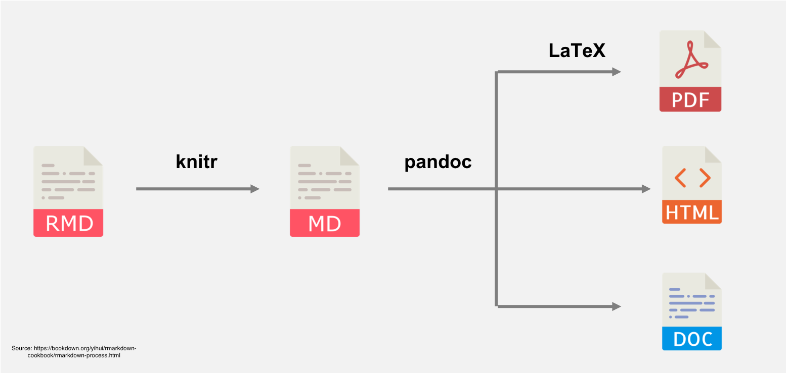
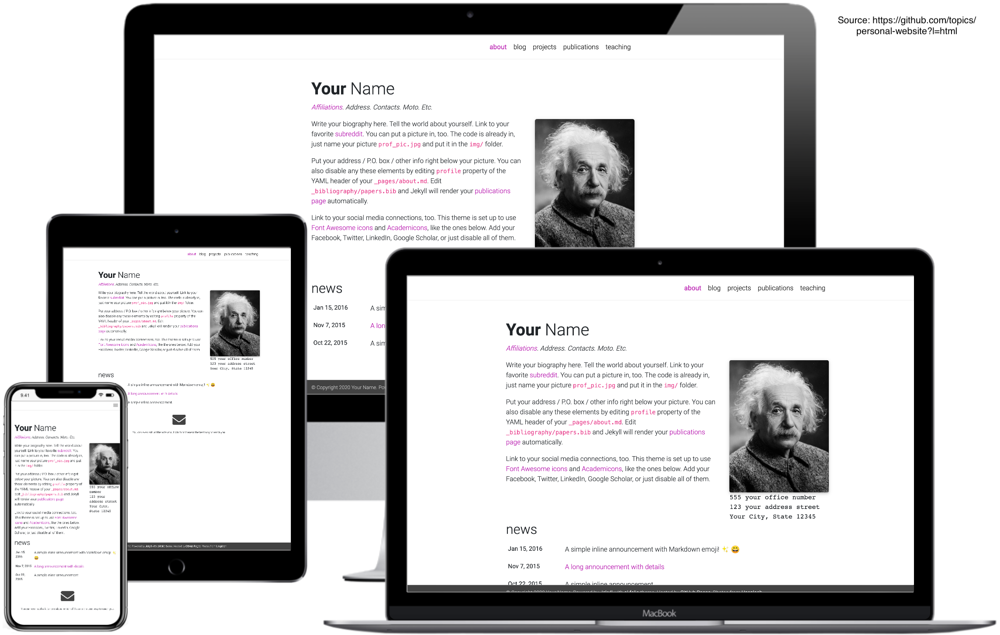

Browse our free online tutorials and recorded webinars on quantitative methods and computational techniques for social scientists — and download slides, code, and materials from our QuantLunch sessions.

---

# Free online tutorials & webinars {#sec-tutorials}

Step-by-step guides on data management, reproducible research, and quantitative methods — plus recorded webinars. We warmly invite you to contribute — please [contact us](mailto:seraphine.maerz@unimelb.edu.au) if you would like to share your tutorials, tips, or suggestions.

::: {.grid}

::: {.g-col-12 .g-col-md-6}
::: {.card}
{width=100%}

### [Quantitative Text Analysis in the Age of LLMs — FIRSA Webinar](https://firsa.eu/posts/llms_webinar/)
**18 Jun 2026** | Alfredo Hernández Sánchez, Seraphine F. Maerz, Bertrand De Longueville

FIRSA webinar recording bringing together researchers from Vilnius University, University of Melbourne, and the Joint Research Centre to discuss quantitative approaches to text analysis with large language models.
:::
:::

::: {.g-col-12 .g-col-md-6}
::: {.card}
{width=100%}

### [Using LLMs to Create Data Analysis Pipelines for Text-as-Data Research](https://www.youtube.com/watch?v=77mhChOgf6g)
**SICSS Melbourne 2026** | Seraphine F. Maerz

Recorded talk from the Summer Institute in Computational Social Science on building reproducible LLM-powered pipelines for text-as-data research.
:::
:::

::: {.g-col-12 .g-col-md-6}
::: {.card}
{width=80%}

### [Coding texts with LLMs using quallmer](../blog/tutorial6/index.qmd)
**04 Feb 2026** | Seraphine F. Maerz

Introduction to the `quallmer` package for LLM-based qualitative coding in R — flexible codebooks, structured outputs, and transparent workflows.
:::
:::

::: {.g-col-12 .g-col-md-6}
::: {.card}
{width=80%}

### [How to use quanteda.llm for text analysis in R](../blog/tutorial5/index.qmd)
**03 Jun 2025** | Seraphine F. Maerz

Use the `quanteda.llm` package for LLM-powered text analysis — summarize, score, and validate large text corpora with OpenAI or Ollama.
:::
:::

::: {.g-col-12 .g-col-md-6}
::: {.card}
{width=80%}

### [How to use an open-source LLM in R for text analysis tasks](../blog/tutorial4/index.qmd)
**27 Jan 2025** | Seraphine F. Maerz

Get started with open-source LLMs for text analysis using Ollama and the `rollama` package in R — free, private, and locally stored.
:::
:::

::: {.g-col-12 .g-col-md-6}
::: {.card}
{width=80%}

### [How to use GitHub for collaborative RStudio projects](../blog/tutorial2/index.qmd)
**03 Oct 2024** | Seraphine F. Maerz

A minimal 3-step guide to using GitHub for collaborative RStudio projects — share code, data, and work together on research papers.
:::
:::

::: {.g-col-12 .g-col-md-6}
::: {.card}
{width=80%}

### [How to use R Studio with Quarto to write nice papers](../blog/tutorial3/index.qmd)
**04 Aug 2024** | Seraphine F. Maerz

Create beautiful Quarto documents combining code, analysis, and narrative — output to PDF, Word, or HTML with ease.
:::
:::

::: {.g-col-12 .g-col-md-6}
::: {.card}
{width=80%}

### [How to code your own personal website with Quarto](../blog/tutorial1/index.qmd)
**21 Jul 2024** | Seraphine F. Maerz

Build and deploy your own personal website with Quarto and GitHub in less than 30 minutes — no previous experience required.
:::
:::

:::

---

# Session materials {#sec-sessions}

## 2026 {#sec-2026}

::: {.grid}

::: {.g-col-12 .g-col-md-6 .g-col-lg-4}
::: {.card}
### Analysing Qualitative Data with LLMs
**31 Mar 2026** | Dr. Seraphine F. Maerz

[View Slides](quallmer_slides.html){.btn .btn-primary}

:::
:::

::: {.g-col-12 .g-col-md-6 .g-col-lg-4}
::: {.card}
{width=80%}

### Quallmer Tutorial
**Hands-on:** Analyzing Political Speeches with LLMs

[View Tutorial](quallmer_tutorial.html){.btn .btn-primary}
:::
:::

::: {.g-col-12 .g-col-md-6 .g-col-lg-4}
::: {.card .password-protected}
### Workshop at Griffith
**LLM Masterclass** | April 2026
(for participants only)

  <input type="password" id="griffith-password" placeholder="Enter password">
  <button class="btn-unlock" onclick="checkPassword()">Unlock</button>

Incorrect password

[Preparation Guide (PDF)](brisbane/Preparations_LLM_Masterclass.pdf){.btn .btn-primary download="Preparations_LLM_Masterclass.pdf"}
[View Tutorial (QMD)](brisbane/quallmer_tutorial.qmd){.btn .btn-primary}
[View Slides](brisbane/quallmer_slides.html){.btn .btn-primary}

:::
:::

:::

## Archive (2024–2025)

Looking for older session materials? Find slides and resources from previous years on our GitHub repository.

[Browse Archive on GitHub](https://github.com/quantilab/sharezone/tree/main){.btn .btn-primary}
